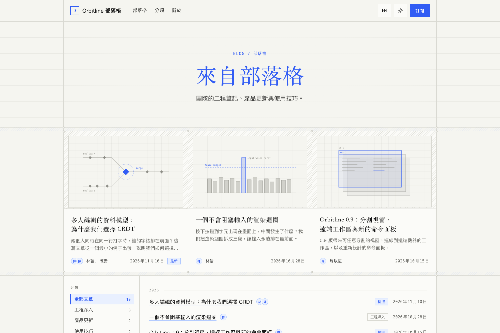

# Gridline

一個以構造格線為骨架的 Hugo 部落格佈景主題：灰白底色、髮絲般的構造線、襯線標題字、等寬字中繼資料，只用一個電光藍作為強調色。版面結構參考 [zed.dev/blog](https://zed.dev/blog)（格線主視覺 → 精選卡片 → 分類欄 + 緊湊文章列表；文章頁右側「本頁內容」），視覺系統與程式碼皆為原創，不包含任何 Zed 的商標、標誌或素材，也與 Zed Industries 無關。



## 功能

- **部落格首頁**：格線主視覺、三張精選卡片（最新文章，第一張標「最新」）、左側分類與作者欄、依年份分組的緊湊文章列表、分頁
- **文章頁**：分類眉標、作者頭像與職稱、日期與閱讀時間、右側「本頁內容」目錄（捲動時高亮目前段落）、延伸連結框、標籤、上一篇／下一篇、相關文章、結尾行動呼籲
- **內文排版**：帶語言標籤與複製按鈕的程式碼區塊、Markdown 提示框（`> [!NOTE]` 等）、帶說明文字的圖片框、表格橫向捲動、註腳、`kbd` 按鍵
- **深淺色**：跟隨系統並提供切換按鈕（記住偏好），或鎖定其中一種
- **多語系**：內建繁體中文與英文介面字串；中文排版使用 CJK 襯線／黑體字型、著重號、嚴格斷行
- **響應式**：1080px 以下目錄收進文章頂端，880px 以下分類變成標籤列，820px 以下主選單收進「選單」按鈕
- 無外部 JavaScript 相依；未啟用 JavaScript 時所有內容與連結仍可使用

需求：Hugo **0.158.0** 以上（使用 `locale` / `label` 語言設定與新的範本目錄結構）。

## 安裝

```sh
cd your-site
git submodule add <這個 repo 的網址> themes/gridline
```

在網站設定檔加入：

```toml
theme = "gridline"

[params]
  mainSections = ["blog"]   # 哪個 section 是部落格

[taxonomies]
  category = "categories"
  tag = "tags"
  author = "authors"        # 作者頭像與作者頁需要這個 taxonomy

# 重要：Hugo 預設不會合併佈景主題的 [markup] 與 [related]。
# 不加這兩行，程式碼上色、圖片說明、中文換行與相關文章設定都不會生效。
[markup]
  _merge = "deep"
[related]
  _merge = "deep"
```

### 執行示範站台

```sh
hugo server -s exampleSite --themesDir ../..
```

示範站台（`exampleSite/`）是雙語的（繁中為預設、英文在 `/en/`），內容為虛構的 Orbitline 團隊部落格。

## 設定參數

| 參數 | 預設 | 說明 |
| --- | --- | --- |
| `colorScheme` | `"auto"` | `auto` 跟隨系統並顯示切換按鈕；`light` / `dark` 鎖定 |
| `accent` / `accentDark` | — | 覆寫強調色（例如 `"#0f766e"`），淺色底色與色帶會自動推導 |
| `monogram` | 標題首字 | 品牌方框裡的字 |
| `description` | — | 首頁副標與頁尾說明 |
| `featuredCount` | `3` | 精選卡片數量 |
| `featuredRow` | `"latest"` | `latest` 放最新文章；`featured` 先放 `featured: true` 的文章 |
| `showReadingTime` / `showToc` / `showRelated` | `true` | 開關閱讀時間、目錄、相關文章 |
| `googleFonts` | `false` | 從 Google Fonts 載入 IBM Plex；關閉時使用系統字型 |
| `hero.eyebrow` / `hero.title` / `hero.subtitle` | — | 首頁主視覺文字 |
| `headerButton.label` / `.url` | — | 頁首右側的主要按鈕 |
| `cta.title` / `.text` / `.eyebrow` / `.buttons[]` | — | 文章結尾的行動呼籲區塊；`buttons` 每項有 `label`、`url`、`primary` |

選單：`menus.main` 是頁首導覽；`menus.footer` 用 `identifier` + `parent` 組成頁尾欄位。完整範例見 `exampleSite/hugo.toml`。

建議另外設定 `hasCJKLanguage = true`，閱讀時間與摘要才會正確計算中文字數。

## 文章 front matter

```yaml
---
title: 多人編輯的資料模型
date: 2026-11-10
description: 卡片摘要與 meta description
authors: [lin-yu]            # authors taxonomy 的 term
categories: [engineering]
tags: [協作, rust]
featured: true               # 顯示「精選」標籤
cover: cover.png             # 卡片圖片：page bundle、assets/ 或網址
subtitle: 標題下方的導言（選用）
guest: 葉知秋                 # 顯示「與 葉知秋 對談」標籤
badge: 自訂標籤               # 覆寫列表上的標籤
links:                       # 目錄下方的「延伸連結」
  - title: 路線圖
    url: /roadmap/
toc: false                   # 關閉這篇的目錄
related: false               # 關閉這篇的相關文章
cta: false                   # 關閉這篇的結尾區塊
---
```

列表上每篇文章只顯示一個標籤，優先順序：`badge` → `featured` → `guest` → 第一個分類。

### 作者

在 `content/authors/<slug>/_index.md` 建立作者頁：

```yaml
---
title: 林語
role: 編輯器核心        # 顯示在署名下方
avatar: avatar.jpg      # 選用：bundle 內、assets/ 或網址；沒有就顯示姓名縮寫
initials: 林            # 選用：覆寫縮寫
---
作者簡介（顯示在作者頁主視覺）
```

分類頁同理：`content/categories/<slug>/_index.md` 可設定 `title` 與 `description`。想要 `/blog/tagged/engineering/` 這種網址，參考示範站台的 `permalinks` 設定（用 `:contentbasename`，不要用 `:slug`，否則會用中文標題當網址）。

## Markdown 擴充

````markdown


```rust {title="src/id.rs"}
// title 會顯示在程式碼區塊的標頭，沒有就顯示語言
```

> [!NOTE]
> 也支援 TIP、IMPORTANT、WARNING、CAUTION。



````

## 客製化

- **額外的 `<head>` 內容**（分析工具、字型）：在網站建立 `layouts/_partials/extend-head.html`
- **樣式**：所有顏色、字型、間距都是 `assets/css/main.css` 開頭的 CSS 變數；在網站建立同路徑的檔案即可整份覆寫
- **介面字串**：在網站的 `i18n/<lang>.toml` 覆寫任一鍵值；新增語言請參考 `i18n/en.toml`

## 授權

MIT
