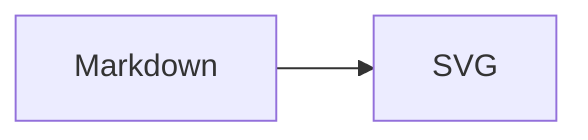

<picture>
  <source media="(prefers-color-scheme: dark)" srcset="images/lockup-dark.svg">
  
</picture>

# Gridline

**English** · [繁體中文](README.zh-TW.md)

A grid-led editorial blog theme for Hugo: hairline construction lines, serif display type, mono metadata and one electric-blue accent, in light and dark. It is the Hugo theme of the [Gridline](https://github.com/rubinette/gridline-style) design system. The page structure is inspired by [zed.dev/blog](https://zed.dev/blog) (grid hero → featured cards → category rail beside a compact post list; an "On this page" column on posts). The visual system and the code are original: the theme contains no Zed trademarks, logos or assets and is not affiliated with Zed Industries.


## Features

- **Blog home**: grid hero, three featured cards (the latest posts; the first is marked "Newest"), category and author rail, compact post list grouped by year, pagination
- **Posts**: category eyebrow, author avatars and roles, date and reading time, an "On this page" table of contents that highlights the current section as you scroll, a "See also" links box, tags, older / newer post links, related posts and a closing call to action
- **Prose**: code blocks with a language label and copy button, Markdown alerts (`> [!NOTE]` and friends), framed figures with captions, horizontally scrolling tables, footnotes, `kbd` keys
- **Mermaid diagrams**: rendered by [Pele](https://github.com/obsidianmd/pele), with colours and type that follow the theme and its light / dark mode, loaded only on pages that have a diagram
- **Light and dark**: follows the system with a toggle that remembers the choice, or lock either one
- **Multilingual**: English and Traditional Chinese interface strings built in, with each language's own date format (`Nov 10, 2026`, `2026年11月10日`); Chinese text uses CJK serif and sans faces, emphasis dots and strict line breaking
- **Sharing**: Open Graph and Twitter / X card tags with a 1200 × 630 preview image from the post, its cover or the site default; favicon and touch icon included
- **Responsive**: below 1080px the table of contents moves to the top of the article, below 880px the category rail becomes a chip list, below 820px the main menu folds behind a "Menu" button
- No external JavaScript dependencies; every page and link still works with JavaScript off

Requires Hugo **0.158.0** or later (for the `locale` / `label` language settings and the new template layout).

## Install

```sh
cd your-site
git submodule add https://github.com/rubinette/hugo-gridline.git themes/hugo-gridline
```

Add to your site configuration:

```toml
theme = "hugo-gridline"

[params]
  mainSections = ["blog"]   # the section that holds the blog

[taxonomies]
  category = "categories"
  tag = "tags"
  author = "authors"        # needed for author avatars and author pages

# Important: Hugo does not merge a theme's [markup] and [related] by default.
# Without these two lines, code highlighting, figure captions, CJK line
# breaking and related-post settings do not take effect.
[markup]
  _merge = "deep"
[related]
  _merge = "deep"
```

### Run the example site

```sh
git clone https://github.com/rubinette/hugo-gridline.git
cd hugo-gridline
hugo server -s exampleSite
```

`exampleSite/themes/hugo-gridline` is a symlink to the repository root, so this works whatever the cloned folder is called. On Windows, if git does not create symlinks (`core.symlinks`), name the folder `hugo-gridline` and run `hugo server -s exampleSite --themesDir ../..` instead.

The example site (`exampleSite/`) is bilingual — English at the root, Traditional Chinese under `/zh-tw/` — and its content is a fictional blog for a team called Orbitline.

## Parameters

| Parameter | Default | Description |
| --- | --- | --- |
| `colorScheme` | `"auto"` | `auto` follows the system and shows the toggle; `light` / `dark` lock the theme |
| `accent` / `accentDark` | — | Override the accent colour (for example `"#0f766e"`); the soft tints and the band colour are derived from it |
| `monogram` | first letter of the title | The letter in the brand box |
| `description` | — | Home page subtitle and footer blurb |
| `featuredCount` | `3` | Number of featured cards |
| `featuredRow` | `"latest"` | `latest` shows the newest posts; `featured` puts posts with `featured: true` first |
| `showReadingTime` / `showToc` / `showRelated` | `true` | Turn reading time, the table of contents and related posts on or off |
| `images` | — | Default social preview image (1200 × 630 PNG or JPG in `static/` or `assets/`, or a URL); set it per language for translated previews |
| `googleFonts` | `false` | Load IBM Plex from Google Fonts; when off, the font stacks fall back to system fonts |
| `hero.eyebrow` / `hero.title` / `hero.subtitle` | — | Home hero text; leave `eyebrow` out unless it adds something the title does not say |
| `headerButton.label` / `.url` | — | Primary button at the right of the header |
| `cta.title` / `.text` / `.eyebrow` / `.buttons[]` | — | Call-to-action block at the end of posts; each button has `label`, `url` and `primary` |

Menus: `menus.main` is the header navigation; `menus.footer` builds footer columns from `identifier` + `parent`. See `exampleSite/hugo.toml` for a complete example.

For Chinese, Japanese or Korean content, also set `hasCJKLanguage = true` so reading time and summaries count characters correctly.

## Post front matter

```yaml
---
title: A data model for many editors
date: 2026-11-10
description: Card summary and meta description
authors: [lin-yu]            # terms of the authors taxonomy
categories: [engineering]
tags: [collaboration, rust]
featured: true               # show the "Featured" badge
cover: cover.png             # card image: page bundle, assets/ or a URL
images: [share.png]          # social preview (optional; a PNG / JPG cover is used otherwise)
subtitle: A lead under the title (optional)
guest: Ada Lovelace          # show a "With Ada Lovelace" badge
badge: Custom label          # override the badge in lists
links:                       # the "See also" box under the table of contents
  - title: Roadmap
    url: /roadmap/
toc: false                   # no table of contents on this post
related: false               # no related posts on this post
cta: false                   # no closing block on this post
---
```

Each post shows one badge in lists, in this order: `badge` → `featured` → `guest` → first category.

### Authors

Create an author page at `content/authors/<slug>/_index.md`:

```yaml
---
title: Lin Yu
role: Editor core        # shown under the byline
avatar: avatar.jpg       # optional: in the bundle, assets/ or a URL; initials otherwise
initials: LY             # optional: override the initials
---
Author bio (shown in the author page hero)
```

Categories work the same way: `content/categories/<slug>/_index.md` can set `title` and `description`. For URLs like `/blog/tagged/engineering/`, copy the `permalinks` settings from the example site (use `:contentbasename`, not `:slug`, or titles in other scripts end up in the URL).

## Markdown extensions

````markdown


```rust {title="src/id.rs"}
// title appears in the code block header; the language shows otherwise
```

> [!NOTE]
> TIP, IMPORTANT, WARNING and CAUTION work too.





````

### Mermaid diagrams

` ```mermaid ` code blocks are rendered to SVG in the browser by [Pele](https://github.com/obsidianmd/pele) 1.13.0, which supports every Mermaid 12.1 diagram type (flowcharts, sequence, state, Gantt, pie and more).

- **No setup.** Pele ships in the theme's `assets/vendor/pele/`; there is no CDN and no outside request.
- **Loaded on demand.** Pages without diagrams load nothing; pages with diagrams download only the diagram types they use (usually 10–20 small files, not all 87).
- **Follows the theme.** Colours and fonts map to the theme's CSS variables, so diagrams follow the light / dark switch and `params.accent` without re-rendering. Series colours alternate between the accent and neutral grays, with at least 4.2:1 contrast against the background in both modes.
- **Syntax errors** show in place of the diagram with the line number; with JavaScript off the source shows instead.
- When a diagram is too wide and has to shrink to fit, zoom in / out buttons appear at its bottom right.
- Every diagram has an "Expand to window" button at its bottom right that scales the whole diagram to fill the window. The expanded view has zoom in / out / reset buttons and can be dragged to pan; Esc, the close button or a click outside the frame closes it.

To restyle diagrams, override the `--pele-*` variables on `.mermaid-diagram, .diagram-viewer-canvas` (see `assets/css/gridline/diagram.css`). To upgrade Pele, put `lazy.js` and `chunks/` from the new npm package's `dist/esm/` into `assets/vendor/pele/<version>/`, then update the version in `layouts/_partials/mermaid.html`.

## Customising

- **Extra `<head>` content** (analytics, fonts): create `layouts/_partials/extend-head.html` in your site
- **Styles**: every colour, font and spacing value is a CSS variable in `assets/css/gridline/tokens.css`. To adjust a few values, override the variables in a `<style>` block in `extend-head.html`; to replace a whole module, create a file at the same path in your site (for example `assets/css/gridline/tokens.css`)
- **Interface strings**: override any key in your site's `i18n/<lang>.toml`; for a new language, start from `i18n/en.toml`

## Brand and icons

Gridline is the name of the design system and of this theme (`hugo-gridline` when you mean the repository). The brand rules (name, mark, colour, type, voice) are in gridline-style's [BRAND.md](https://github.com/rubinette/gridline-style/blob/main/BRAND.md).

- **Your site is your brand.** The header, footer and card placeholders show your monogram (`params.monogram`), not the Gridline mark.
- **Icons.** The theme ships the Gridline mark as a default `favicon.svg` (follows light / dark), `favicon.png` (32 px) and `apple-touch-icon.png` (180 px). Put files with the same names in your site's `static/` to replace them.
- **Social preview.** Set `params.images` to a 1200 × 630 image. The example site's `exampleSite/assets/og/og.svg` follows the Gridline preview layout with the site's own monogram and name; copy it, change the text and export a PNG.
- The example content is about Orbitline, a **fictional** product; the footer and the first posts say so. Replace it all when you start your own site.

## Style source: gridline-style

`assets/css/gridline/` and `assets/js/gridline/` are not written here: they are synced from `src/css` and `src/js` of the design system [gridline-style](https://github.com/rubinette/gridline-style), and the first line of each file names the source version. The icons in `static/` and the README lockups in `images/` come from its `brand/` folder the same way. `layouts/_partials/head.html` concatenates the modules in a fixed order (tokens, base, construction, components, prose, blog, diagram, syntax).

To change the styles, edit them in gridline-style and sync them back:

```bash
python3 scripts/sync-gridline-style.py            # reads ../gridline-style by default; or use --from / $GRIDLINE_STYLE
python3 scripts/sync-gridline-style.py --check    # report whether the theme matches gridline-style
```

## License

MIT.

`assets/vendor/pele/` contains [Pele](https://github.com/obsidianmd/pele) (MIT, © kepano). Its licence, together with that of the Lucide icons it uses (ISC), is kept in `assets/vendor/pele/1.13.0/LICENSE.txt` and is published with the site alongside the diagrams.
