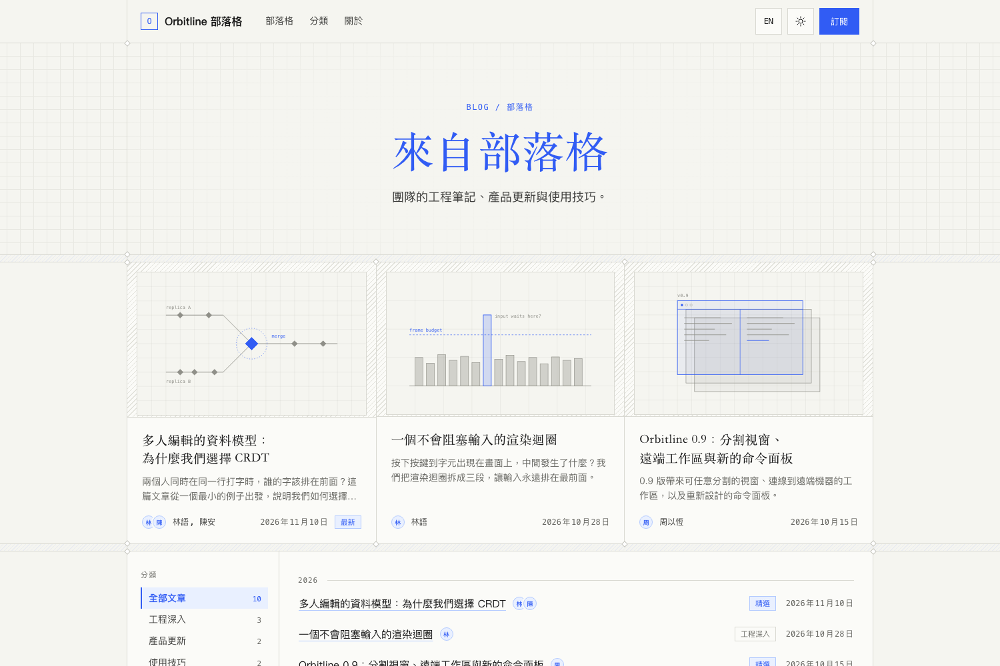
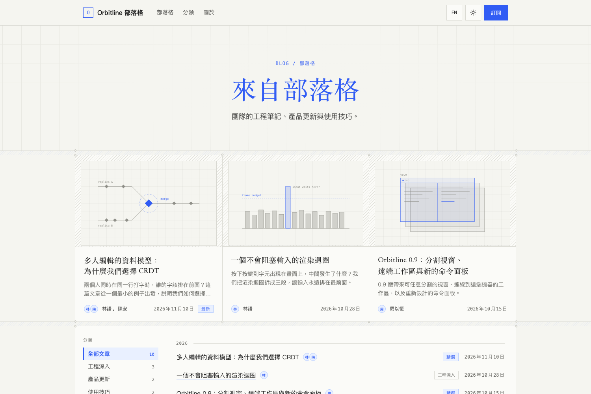
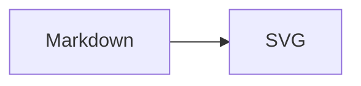

<picture>
  <source media="(prefers-color-scheme: dark)" srcset="images/lockup-dark.svg">
  
</picture>

# Gridline

[English](README.md) · **繁體中文**

以構造線為骨架的 Hugo 部落格佈景主題：細線導軌、襯線標題、等寬中繼資料與單一電光藍，支援淺色與深色。它是 [Gridline](https://github.com/rubinette/gridline-style) 設計系統的 Hugo 佈景主題。版面結構參考 [zed.dev/blog](https://zed.dev/blog)（格線主視覺 → 精選卡片 → 分類欄 + 緊湊文章列表；文章頁右側「本頁內容」），視覺系統與程式碼皆為原創，不包含任何 Zed 的商標、標誌或素材，也與 Zed Industries 無關。





## 功能

- **部落格首頁**：格線主視覺、三張精選卡片（最新文章）、左側分類與作者欄、依年份分組的緊湊文章列表、分頁
- **文章頁**：分類眉標、作者頭像、日期與閱讀時間、右側目錄（捲動時高亮目前段落）、延伸連結框、標籤、較舊／較新文章連結、相關文章、結尾行動呼籲
- **內文排版**：帶語言標籤與複製按鈕的程式碼區塊、Markdown 提示框（`> [!NOTE]` 等）、帶說明文字的圖片框、表格橫向捲動、註腳、`kbd` 按鍵
- **Mermaid 圖表**：以 [Pele](https://github.com/obsidianmd/pele) 渲染，顏色與字型跟著佈景主題和深淺色走，只在有圖表的頁面載入
- **深淺色**：跟隨系統並提供切換按鈕（記住偏好），或鎖定其中一種
- **多語系**：內建繁體中文與英文介面字串，日期依語言書寫（`2026年11月10日`、`Nov 10, 2026`）；中文排版使用 CJK 襯線／黑體字型、著重號、嚴格斷行
- **分享**：Open Graph 與 Twitter／X 卡片標籤，預覽圖（1200 × 630）依序取自文章設定、封面或站台預設；內附網站圖示與觸控圖示
- **響應式**：1080px 以下目錄收進文章頂端，880px 以下分類變成標籤列，820px 以下主選單收進「選單」按鈕
- 無外部 JavaScript 相依；未啟用 JavaScript 時所有內容與連結仍可使用

需求：Hugo **0.158.0** 以上（使用 `locale` / `label` 語言設定與新的範本目錄結構）。

## 安裝

```sh
cd your-site
git submodule add https://github.com/rubinette/hugo-gridline.git themes/hugo-gridline
```

在網站設定檔加入：

```toml
theme = "hugo-gridline"

[params]
  mainSections = ["blog"]   # 哪個 section 是部落格

[taxonomies]
  category = "categories"
  tag = "tags"
  author = "authors"        # 作者頭像與作者頁需要這個 taxonomy

# 重要：Hugo 預設不會合併佈景主題的 [markup] 與 [related]。
# 不加這兩行，程式碼上色、圖片說明、中文換行與相關文章設定都不會生效。
[markup]
  _merge = "deep"
[related]
  _merge = "deep"
```

### 執行示範站台

```sh
git clone https://github.com/rubinette/hugo-gridline.git
cd hugo-gridline
hugo server -s exampleSite
```

`exampleSite/themes/hugo-gridline` 是指向 repo 根目錄的符號連結，所以不論資料夾叫什麼名字都能直接執行。Windows 上若 git 沒有啟用符號連結（`core.symlinks`），請把資料夾命名為 `hugo-gridline`，改用 `hugo server -s exampleSite --themesDir ../..`。

示範站台（`exampleSite/`）是雙語的（英文為預設、繁體中文在 `/zh-tw/`），內容為虛構的 Orbitline 團隊部落格。

## 設定參數

| 參數 | 預設 | 說明 |
| --- | --- | --- |
| `colorScheme` | `"auto"` | `auto` 跟隨系統並顯示切換按鈕；`light` / `dark` 鎖定 |
| `accent` / `accentDark` | — | 覆寫強調色（例如 `"#0f766e"`），淺色底色與色帶會自動推導 |
| `monogram` | 標題首字 | 品牌方框裡的字 |
| `description` | — | 首頁副標與 meta 描述 |
| `featuredCount` | `3` | 精選卡片數量 |
| `featuredRow` | `"latest"` | `latest` 放最新文章；`featured` 先放 `featured: true` 的文章 |
| `showReadingTime` / `showToc` / `showRelated` | `true` | 開關閱讀時間、目錄、相關文章 |
| `images` | — | 預設的社群預覽圖（放在 `static/` 或 `assets/` 的 1200 × 630 PNG／JPG，或網址）；可依語言分別設定 |
| `webFonts` | `false` | 載入網路字型，以 `unicode-range` 分片，只下載頁面用到的字：IBM Plex Serif／Sans 與 Lilex（Google Fonts）；中文頁面另載思源宋體 Noto Serif TC（標題）與 IBM Plex Sans TC（內文，由網站自己的 `static/fonts/` 提供）。關閉時退回系統字型（中文為思源黑體、蘋方、微軟正黑）。舊名 `googleFonts` 仍可使用 |
| `hero.eyebrow` / `hero.title` / `hero.subtitle` | — | 首頁主視覺文字；`eyebrow` 若只是重複標題就省略 |
| `headerButton.label` / `.url` | — | 頁首右側的主要按鈕 |
| `cta.title` / `.text` / `.buttons[]` | — | 文章結尾的行動呼籲區塊；`buttons` 每項有 `label`、`url`、`primary`。`text` 只在說出標題和按鈕沒說的事時才加 |

選單：`menus.main` 是頁首導覽；`menus.footer` 用 `identifier` + `parent` 組成頁尾欄位。完整範例見 `exampleSite/hugo.toml`。

建議另外設定 `hasCJKLanguage = true`，閱讀時間與摘要才會正確計算中文字數。

## 文章 front matter

```yaml
---
title: 多人編輯的資料模型
date: 2026-11-10
description: 卡片摘要與 meta description
authors: [lin-yu]            # authors taxonomy 的 term
categories: [engineering]
tags: [協作, rust]
featured: true               # featuredRow = "featured" 時排在精選列前面
cover: cover.png             # 卡片圖片：page bundle、assets/ 或網址
images: [share.png]          # 社群預覽圖（選填；未設定時使用 PNG／JPG 封面）
subtitle: 標題下方的導言（選用）
guest: 葉知秋                 # 顯示「與 葉知秋 對談」標籤
badge: 自訂標籤               # 覆寫列表上的標籤
links:                       # 目錄下方的「延伸連結」
  - title: 路線圖
    url: /roadmap/
toc: false                   # 關閉這篇的目錄
related: false               # 關閉這篇的相關文章
cta: false                   # 關閉這篇的結尾區塊
---
```

列表上每篇文章只顯示一個標籤，優先順序：`badge` → `featured` → `guest` → 第一個分類。

### 作者

在 `content/authors/<slug>/_index.md` 建立作者頁：

```yaml
---
title: 林語
role: 編輯器核心        # 顯示在作者頁的名字上方
avatar: avatar.jpg      # 選用：bundle 內、assets/ 或網址；沒有就顯示姓名縮寫
initials: 林            # 選用：覆寫縮寫
---
作者簡介（顯示在作者頁主視覺）
```

分類頁同理：`content/categories/<slug>/_index.md` 可設定 `title` 與 `description`。想要 `/blog/tagged/engineering/` 這種網址，參考示範站台的 `permalinks` 設定（用 `:contentbasename`，不要用 `:slug`，否則會用中文標題當網址）。

## Markdown 擴充

````markdown


```rust {title="src/id.rs"}
// title 會顯示在程式碼區塊的標頭，沒有就顯示語言
```

> [!NOTE]
> 也支援 TIP、IMPORTANT、WARNING、CAUTION。





````

### Mermaid 圖表

` ```mermaid ` 程式碼區塊會在瀏覽器中由 [Pele](https://github.com/obsidianmd/pele) 1.13.0 渲染成 SVG，支援 Mermaid 12.1 的所有圖表類型（流程圖、循序圖、狀態圖、甘特圖、圓餅圖等）。

- **不需要任何設定**。Pele 存放在佈景主題的 `assets/vendor/pele/` 裡，不經過 CDN，也沒有對外連線。
- **只在需要時載入**。沒有圖表的頁面不會載入任何東西；有圖表的頁面只下載用到的圖表類型（通常 10–20 個小檔案，不是全部 87 個）。
- **跟著佈景主題走**。顏色、字型都對應到佈景主題的 CSS 變數，所以會跟著深淺色切換和 `params.accent`，不需要重新渲染。圖表的系列色以強調色和中性灰交錯，在兩種模式下對背景的對比都至少 4.2:1。
- **語法錯誤**會直接顯示在圖表位置，標出行號；未啟用 JavaScript 時則顯示原始碼。
- 圖表太寬、必須縮小才放得下時，右下角會出現放大／縮小按鈕。
- 每張圖表右下角都有「放大到視窗」按鈕，會把整張圖縮放到填滿視窗顯示；放大後右下角有放大／縮小／重設按鈕，可拖曳平移；按 Esc、關閉按鈕或點擊外框外側即可關閉。

要調整圖表樣式，可以覆寫 `.mermaid-diagram, .diagram-viewer-canvas` 上的 `--pele-*` 變數（見 `assets/css/gridline/diagram.css`）。要升級 Pele：把新版 npm 套件 `dist/esm/` 裡的 `lazy.js` 和 `chunks/` 放進 `assets/vendor/pele/<版本>/`，再更新 `layouts/_partials/mermaid.html` 裡的版本號。

## 客製化

- **額外的 `<head>` 內容**（分析工具、字型）：在網站建立 `layouts/_partials/extend-head.html`
- **樣式**：所有顏色、字型、間距都是 `assets/css/gridline/tokens.css` 裡的 CSS 變數。要調整個別數值，在 `extend-head.html` 加一段 `<style>` 覆寫變數；要整份替換某個模組，在網站建立同路徑的檔案（例如 `assets/css/gridline/tokens.css`）
- **介面字串**：在網站的 `i18n/<lang>.toml` 覆寫任一鍵值；新增語言請參考 `i18n/en.toml`

## 品牌與圖示

Gridline 是設計系統與本佈景主題的名稱（指程式庫時寫 `hugo-gridline`）。命名、標誌、色彩、字型與文案語氣等品牌規範，見 gridline-style 的 [BRAND.zh-TW.md](https://github.com/rubinette/gridline-style/blob/main/BRAND.zh-TW.md)。

- **你的網站是你的品牌。** 頁首、頁尾與卡片預留圖顯示的是你的字首標記（`params.monogram`），不是 Gridline 標誌。
- **圖示。** 佈景主題預設附上 Gridline 標誌：`favicon.svg`（跟著深淺色切換）、`favicon.png`（32 px）與 `apple-touch-icon.png`（180 px）。在網站的 `static/` 放同名檔案即可替換。
- **社群預覽圖。** 把 `params.images` 設為 1200 × 630 的圖片。示範站台的 `exampleSite/assets/og/og-zh-tw.svg` 依 Gridline 預覽圖版型，換上站台自己的字首標記與名稱；複製後改文字再匯出 PNG 即可。
- 示範內容裡的 Orbitline 是**虛構**產品，頁尾與前幾篇文章都有註明。建立自己的網站時請全部替換。

## 樣式來源：gridline-style

`assets/css/gridline/` 與 `assets/js/gridline/` 不是在這裡手寫的，而是從設計系統 [gridline-style](https://github.com/rubinette/gridline-style) 的 `src/css`、`src/js` 同步過來；每個檔案第一行都註明來源版本。`static/` 裡的圖示與 README 的標誌圖也同樣從它的 `brand/` 資料夾同步。`layouts/_partials/head.html` 依固定順序合併這些模組（tokens、base、construction、components、prose、blog、diagram、syntax）。

要修改樣式，請在 gridline-style 修改後同步回來：

```bash
python3 scripts/sync-gridline-style.py            # 預設讀取 ../gridline-style，或用 --from / $GRIDLINE_STYLE 指定
python3 scripts/sync-gridline-style.py --check    # 檢查是否與 gridline-style 一致
```

## 授權

MIT。

`assets/vendor/pele/` 內含 [Pele](https://github.com/obsidianmd/pele)（MIT，© kepano），授權條款與其中引用的 Lucide 圖示（ISC）一併保留在 `assets/vendor/pele/1.13.0/LICENSE.txt`，並會隨圖表一起發布到網站。
