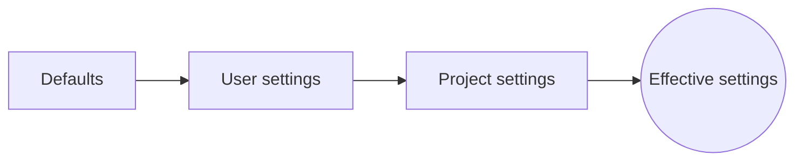

A settings file always starts small, until one day it is the file the whole team shares and nobody dares to touch.

## Types

Every settings key has a matching struct definition, and the editor uses it for completion and live validation.

```rust
#[derive(Deserialize)]
#[serde(deny_unknown_fields)]
pub struct EditorSettings {
    pub tab_size: NonZeroU8,
    pub soft_wrap: SoftWrap,
    pub format_on_save: bool,
}
```

## Layers

Settings come in three layers: defaults, user settings and project settings. Later layers override earlier ones, and every value can tell you which layer it came from.



| Layer | Location | In version control |
| --- | --- | --- |
| Defaults | Built in | No |
| User | `~/.config/orbit/settings.toml` | Up to you |
| Project | `.orbit/settings.toml` | Yes |

> [!CAUTION]
> Project settings apply to every collaborator. Keep personal preferences, such as font size, out of them.
