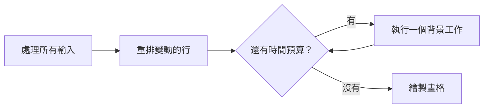

按下按鍵到字元出現在畫面上，中間發生了什麼？在大多數編輯器裡，答案是「看情況」：如果剛好遇到語法分析、檔案監看或外掛在做事，那一次按鍵就得排隊。

我們的目標很單純：**輸入永遠排在最前面。**

## 三段式迴圈

每一個畫格被拆成三段：

1. 處理所有待處理的輸入事件，立即更新文字緩衝區
2. 只重新排版受影響的行
3. 把剩下的時間預算交給背景工作



```ts {title="loop.ts"}
function frame(budget: number) {
  const start = performance.now();
  drainInput();                 // never deferred
  layoutDirtyLines();
  while (performance.now() - start < budget) {
    if (!background.runOne()) break;
  }
  requestAnimationFrame(() => frame(budget));
}
```

## 背景工作要能被切開

關鍵在於背景工作必須可以在任何時間點暫停。語法分析器改成增量式，每次只處理一小段；檔案索引則改成以檔案為單位的工作佇列。

> [!TIP]
> 如果某個背景工作無法切成小段，就把它移到另一個執行緒，不要讓它出現在畫格迴圈裡。

## 量測

我們在每一個畫格記錄「輸入到繪製」的時間，並把超出預算的畫格標成紅色。圖表本身不重要，重要的是讓每一個超出預算的畫格都能追溯到原因。
